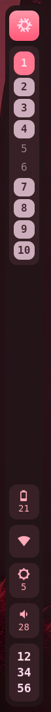
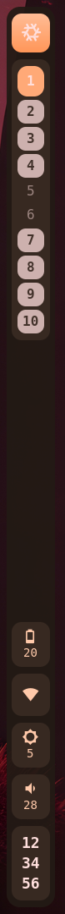
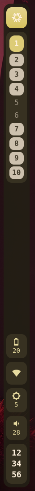
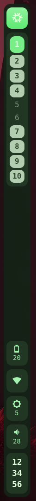
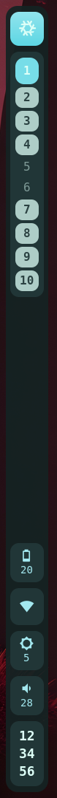
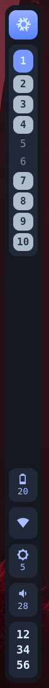
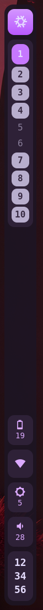
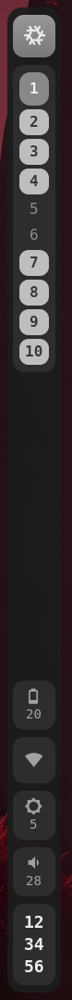

<h1 style="text-align: center" align="center">

`tkbar`

</h1>

<p align="center">
    <a href="https://github.com/tkr-sh/tkbar">
        
    </a>
    <a href="https://github.com/tkr-sh/tkbar/actions">
        
    </a>
    <a href="https://crates.io/crates/tkbar">
        
    </a>
    <a href="https://github.com/tkr-sh/tkbar">
        
    </a>
</p>

<p align="center">
A minimalist, hardened status bar for Wayland.
</p>

<div style="display: flex; flex-direction: row; justify-content: center; align-items: center;" align="center">










</div>

`tkbar` is small and opinionated on purpose: every optional piece is feature-gated so it can be compiled out, and what doesn't exist is hardcoded by design. A single TOML file tunes the layout, behaviour, and security policy, a CSS file can restyle everything, and the rest is baked in. Want to go deeper? Fork it, or open a PR with proper feature gating (See [CONTRIBUTING.md](./docs/CONTRIBUTING.md)) .

## ✨ Features

- 🖥️ **Wayland compositors** — [niri](https://github.com/YaLTeR/niri) (default), [Hyprland](https://github.com/hyprwm/Hyprland), and [sway](https://github.com/swaywm/sway), selected at build time via Cargo features.
- 🧩 **Components** — clickable workspaces, battery, Wi-Fi (SSID & signal), brightness, volume, clock, spacer and a logo glyph.
- 📐 **Any edge** — vertical (`left`/`right`) or horizontal (`top`/`bottom`) bar, with adjustable thickness.
- 🎨 **Themes** — ten compiled-in color themes, plus an optional user CSS file that overrides the base stylesheet.
- ⚙️ **Optional configuration** — TOML and CSS live behind the `config` feature; build with `--no-default-features --features renderer-gtk,<color>` and no parser is linked at all.
- 🔒 **Hardened** — safe Rust apart from one audited `unsafe` call that seeds the GTK-hardening env vars at startup, no network code, no dynamic loading, no panics on external data, a minimal, auditable dependency tree, and a GTK stack trimmed at startup: no GPU driver, no D-Bus, no image loaders. Measured, not claimed (see [Security](#-security)).
- 💻 **CLI** — optional `clap` feature gate provides `--help`, `--version`, and `--config <path>` flags for overriding the configuration file path at runtime.
- 🚧 **Coming soon** — optional `logging` (the `log` crate) feature gate, for people who want more batteries included.

## 📦 Dependencies

The bar aims for a minimal dependency tree: every crate and library is code that runs with your full user privileges, so only what is strictly needed is pulled in. There is currently no logging framework (just `eprintln!`), and config parsing is feature-gated so it can be dropped entirely.

### Build-time

| Dependency | Notes |
| --- | --- |
| Rust (edition 2024) | stable toolchain for builds; nightly only in the devshell for `rustfmt`/`clippy` |
| GTK4 >= 4.12 | C library, resolved through `pkg-config` |
| gtk4-layer-shell >= 1.0 | C library implementing the layer-shell protocol |
| glib | comes with GTK4 |

On top of the GTK renderer's bindings (`gtk4`, `gtk4-layer-shell`), pulled in by the default `renderer-gtk` feature, the default feature set adds `all_components` (`battery`, `brightness`, `clock`, `volume`, `wifi` — pulling in `async-channel`, `pipewire`, and `neli-wifi`), the `clap` crate (`cli`), `directories`/`serde`/`toml` (`config`), and `niri-ipc` (`niri`). Of the `config` crates, only `serde` is already present transitively via the default `niri` backend (pulled in by `niri-ipc`), so it adds no new transitive code; `directories` and `toml` are genuinely new dependencies, and `toml` in turn pulls in its own small tree. If you build with the `hyprland` backend instead of `niri`, `serde` is also a new dependency. The `sway` backend pulls in `serde`, `serde_json`, and `thiserror` (via `swayipc`/`swayipc-types`). Build with `--no-default-features --features renderer-gtk,<color>` (exactly one renderer and one color feature are required) to drop the optional crates entirely: no TOML parser is then linked at all.

### Run-time

| Dependency | How it is used | Trust level |
| --- | --- | --- |
| GTK4 / Pango / Cairo / FreeType | linked, renders everything in software (cairo renderer) | large audited C codebase, keep it updated |
| gtk4-layer-shell | linked, positions the window | small C library |
| a Wayland compositor ([niri](https://github.com/YaLTeR/niri), [Hyprland](https://github.com/hyprwm/Hyprland), or [sway](https://github.com/swaywm/sway)) | Wayland protocol | fully trusted, see [SECURITY.md](docs/SECURITY.md) |
| the compositor's IPC (niri IPC / Hyprland IPC / sway IPC) | Unix socket, workspace list/buttons | trusted (it *is* the compositor) |
| PipeWire | Unix socket client, gets/sets volume and mute natively | local daemon, node params parsed defensively |
| nl80211 (`neli-wifi`) | kernel netlink socket, reads Wi-Fi SSID/signal | linked, carries untrusted data (SSID) |
| sysfs (`/sys/class/backlight`, `/sys/class/power_supply`) | read directly; backlight also written directly (needs group write access, see the [NixOS module](docs/CONFIGURATION.md#️-nixos-module)) | kernel-provided |

What is deliberately **not** in the process, even though a default GTK4 application would have it:

| Subsystem | Why it is off | How |
| --- | --- | --- |
| Mesa / EGL / GL / Vulkan drivers | a gtk4 bar has no use for a GPU, and GPU drivers are `dlopen`-ed at runtime | `GSK_RENDERER=cairo`, `GDK_DISABLE=gl,vulkan,dmabuf` |
| D-Bus: AT-SPI accessibility bus | would export the whole widget tree to every process on the session bus | `GTK_A11Y=none` |
| D-Bus: `xdg-desktop-portal` | settings/theme lookups the bar does not need | `GDK_DEBUG=no-portals` |
| gdk-pixbuf image loaders (PNG, SVG, TIFF, ...) | the bar draws text only; image parsers are a classic attack surface | `GDK_PIXBUF_MODULE_FILE` → empty cache |
| X11 fallback | X11 has no client isolation, and layer-shell needs Wayland anyway | `GDK_BACKEND=wayland` |

These are set by the binary itself before GTK initializes (`harden_gtk_env` in `src/ui/gtk/mod.rs`), and the Nix wrapper sets the same values again as defense in depth. The bar spawns no external processes: each backend talks to the kernel (nl80211, sysfs), the compositor's IPC socket, or a local daemon (PipeWire) directly.

## 📥 Installation

See [docs/INSTALL.md](docs/INSTALL.md) for Nix, Arch Linux (`PKGBUILD`), and
source builds.

## ⚙️ Configuration

Optional and strictly validated: unknown keys are rejected, and a missing file
falls back to the hardcoded default. See
[docs/CONFIGURATION.md](docs/CONFIGURATION.md) for the full TOML format, the
optional CSS overloading, how to select a theme or drop the `config` feature
from Nix, and the NixOS and Home Manager modules.

## 💻 Usage

When built with the `cli` feature (enabled by default):

```
tkbar [OPTIONS]
```

| Flag | Description |
| --- | --- |
| `--help` | Print help information |
| `--version` | Print version |
| `--config <PATH>` | Path to configuration file (requires the `cli` and `config` features) |


Example:

```sh
tkbar --config ~/.config/tkbar/alt.toml
```

The `--config` flag overrides the default `$XDG_CONFIG_HOME/tkbar/config.toml`
path for that invocation only.

## 🔒 Security

A status bar runs unsandboxed with your full user privileges, so attack surface
is taken seriously: minimal dependencies, safe Rust — `unsafe_code` is denied
workspace-wide, and the only `unsafe` in the project is a single audited
`glib::setenv` call at startup, allowed with `#[expect(unsafe_code)]`
— no panics on external data, no network code, no
dynamic loading, a pinned, reproducible build, and a GTK stack stripped of
everything the bar does not draw with.

The dependency graph is enforced in CI: `cargo deny check advisories bans
licenses sources` fails on vulnerable, unsound, yanked, unlicensed or
non-crates.io crates across the whole feature matrix, and `cargo machete`
rejects unused dependencies.

See [docs/SECURITY.md](docs/SECURITY.md) for the full threat model, the enforced
security properties, the measured footprint, and how to report a vulnerability.

## 🌱 Origin

I was unsatisfied with the state of Wayland bars and shells (bloat, huge attack surface, not enough config options, protocols left unhandled), so I wrote a minimal thing that worked for me. It has since grown into a bar meant to work for anyone: multiple compositor backends, themes, Nix packaging, and a documented security model, without giving up on minimalism.
